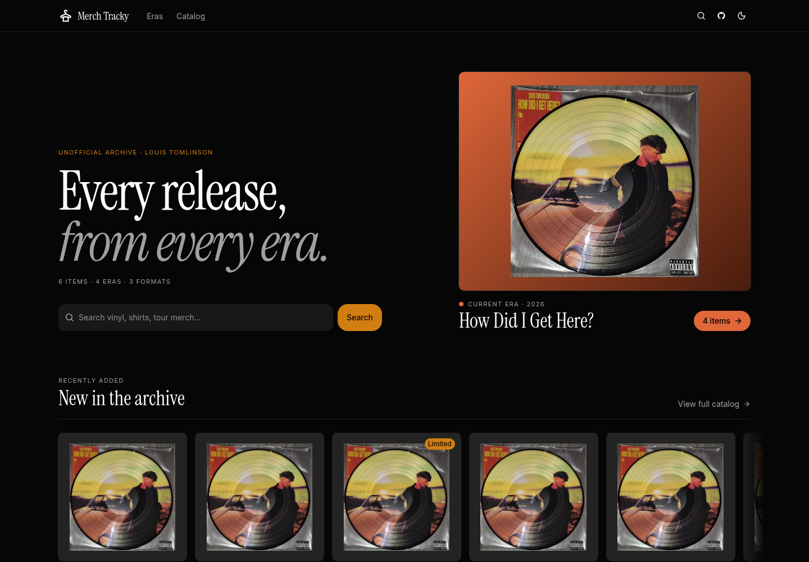
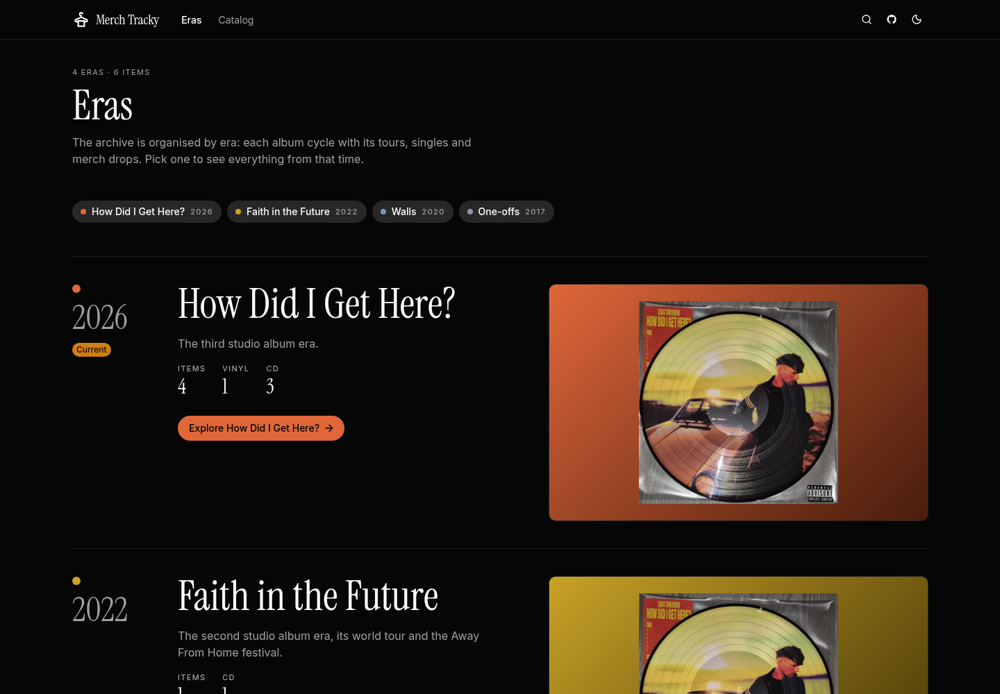
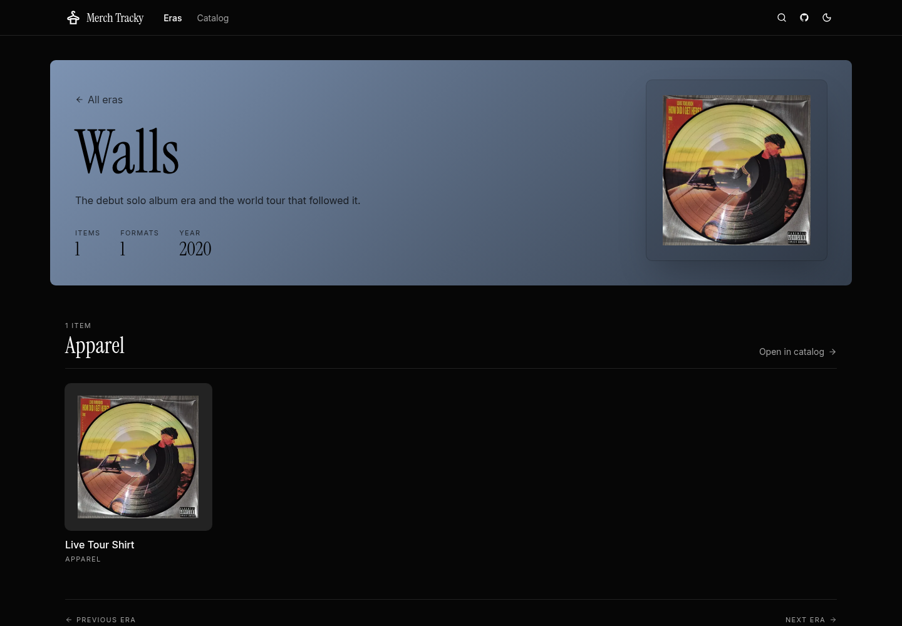
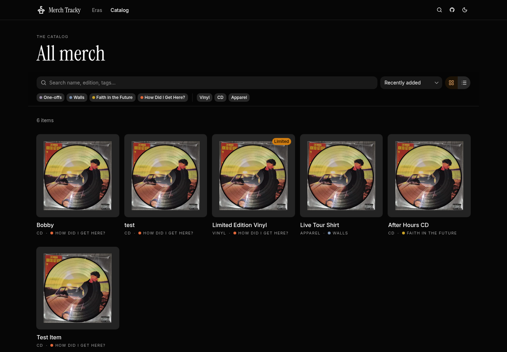
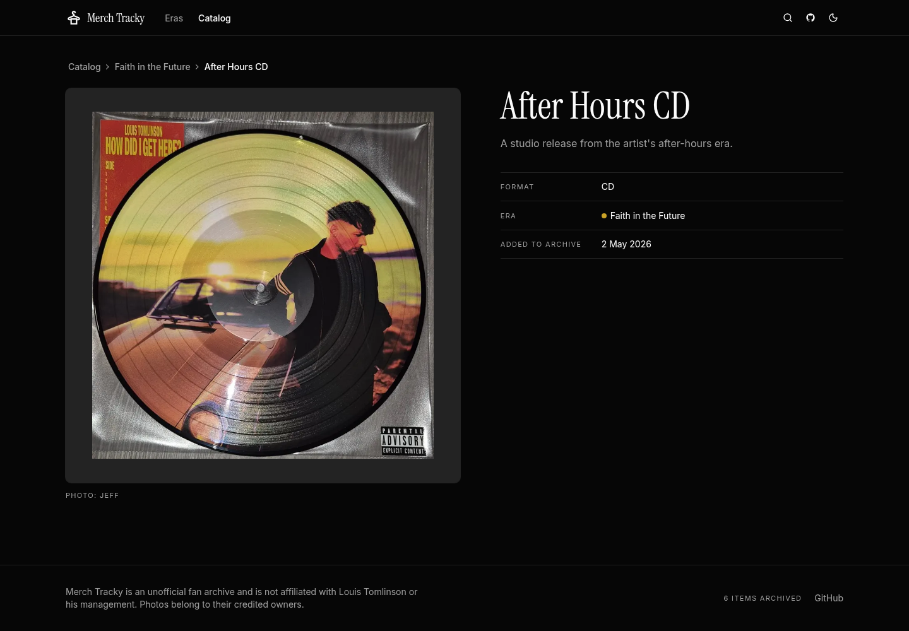

  <picture>
    <source media="(prefers-color-scheme: dark)" srcset="public/icon.svg">
    
  </picture>

<h1 align="center">Merch Tracky</h1>

An unofficial public archive of Louis Tomlinson merchandise, browsable by era, format and release.

## Features

- **Eras**: a timeline of every album cycle. Each era page groups its merch by format and uses the era's colour.
- **Catalog**: instant search, era and format filters, sorting, and grid or list views. Filtered views can be shared by URL.
- **Item pages**: photo gallery with credits, release details, and related items from the same era.
- Light and dark themes.
- Fully static. Every page is pre-rendered at build time.

## Screenshots

| Eras                                 | Era                                |
| ------------------------------------ | ---------------------------------- |
|    |    |
| **Catalog**                          | **Item**                           |
|  |  |

## Built with

[Next.js](https://nextjs.org), [HeroUI](https://heroui.com) and [Tailwind CSS](https://tailwindcss.com).

## License

[MIT](LICENSE)
